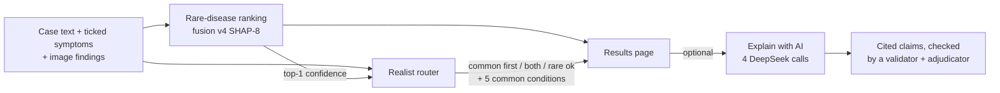

# MediPurse

**Hospital and clinic management with AI-assisted diagnosis for rare and everyday conditions.**

MediPurse runs a clinic day to day:
- patients, appointments and reminders;
- prescriptions and a pharmacy with stock;
- feedback;
- a patient portal.

On top of that it adds a **diagnosis assistant**:
- it ranks 1,464 rare diseases from a case description;
- a "realist" check decides whether common causes should come first;
- it explains its suggestions with cited evidence.

> **Research prototype, not a diagnostic device.** AI suggestions support clinical judgement and
> never replace it. Use demo or published cases only; do not send real patient data to an external API.

---

## Contents

1. [Highlights](#highlights)
2. [Who does what](#who-does-what)
3. [How the AI diagnosis works](#how-the-ai-diagnosis-works)
4. [Metrics](#metrics)
5. [Quick start](#quick-start)
6. [Configuration](#configuration)
7. [Project layout](#project-layout)
8. [Data, models and scripts](#data-models-and-scripts)
9. [Testing and evaluation](#testing-and-evaluation)
10. [Security and privacy](#security-and-privacy)
11. [Limitations](#limitations)
12. [Credits and licences](#credits-and-licences)
13. [Further documentation](#further-documentation)

---

## Highlights

| Area | What you get |
|---|---|
| **AI diagnosis** | Rare-disease ranking (1,464 diseases) in about 0.3 s. A realist router puts common causes first when that makes more sense. Optional DeepSeek explanation that cites the case and disease evidence. Up to 4 clinical images per case. |
| **Symptom capture** | Search across 18,555 OptimusKG/HPO phenotypes, tick lists of 81 everyday symptoms, negation-aware text reading ("no fever"). |
| **History-taking agent** | Patients describe their symptoms in the portal before a visit (AI or guided interview). Red flags alert the doctor by email. The doctor gets a structured summary. |
| **Prescribing** | Fast form with dropdowns and an auto-calculated quantity. Suggestions linked to the diagnosis (first-line options for everyday conditions; medicines used in published case reports for rare ones). Contraindication warnings. A patient-specific "medicines to avoid" list from recorded reactions. |
| **Pharmacy** | Stock with batches, expiry and prices. A dispensing queue: stock is deducted only when medicines are handed over. Counter sales with printable receipts. |
| **Appointments** | Staff and online booking, calendar invites, reminders 24 h and 2 h before, staff alerts for new online bookings. |
| **Patient portal** | Book and cancel, symptom check-in with photos, current medicines, email preferences, one-time feedback links. |
| **Reports** | Excel medicine reports for any period; email log; feedback overview. |
| **Interface** | Light and dark mode, phone layouts (slide-out menu for staff, bottom tab bar for patients), public landing page. |

## Who does what

| Role | Main tasks |
|---|---|
| **Registrar / Admin** | Hospitals, clinics, staff accounts; sees and can do everything across clinics |
| **Doctor** | Patients, appointments, diagnoses, prescribing, AI diagnosis, patient histories, reactions |
| **Receptionist** | Registration, booking, feedback, handing over prescribed medicines; stock only if the clinic has no pharmacist |
| **Pharmacist** | Stock and prices, dispensing, counter sales, medicine reports; no access to patient records or AI |
| **Patient** (portal) | Booking, symptom check-in, medicines, reminders, feedback |

One staff account can hold several roles, for example receptionist and pharmacist. Every
permission check uses all of a person's roles.

## How the AI diagnosis works



1. **Rare-disease ranking.** The team's frozen *fusion v4 SHAP-8* retriever (`handoff/`, built by Animesh Pathak and Aarav Singh) ranks
   1,464 Orphanet diseases.
   - A TF-IDF/SGD classifier picks 100 candidates.
   - Mass-pruned bag-of-words disease centroids and a 32-dimensional SVD add signals.
   - A LightGBM LambdaRank reranker with 8 features re-scores the candidates.
   - A fixed blend gives the final order.
   - Each suggestion shows the matched terms, its Orphanet profile and knowledge-graph evidence.
2. **Realist router** (`app/router.py`).
   - A small logistic model estimates whether the case is an everyday presentation.
   - Inputs: the ranking's confidence, mentions of specialised tests, how well the symptoms fit a
     common condition, rare-disease cues, and age.
   - It outputs *start with common causes*, *rule out common causes too* or *rare-disease workup
     is reasonable*, with up to 5 common conditions and a plain-language reason.
   - With DeepSeek credit, an AI review can refine the verdict in the background.
3. **Explain with AI** (optional, about 17 s).
   - One call extracts findings.
   - One call audits the candidates blind: names are shuffled and ranks hidden.
   - One call writes claims that must cite the case or the disease evidence.
   - An adjudicator checks every citation.
   - Claims that fail are hidden or softened. The ranking order is never changed by the LLM.
4. **Without LLM credit** every step falls back to its rule-based or guided mode, so nothing breaks.

## Metrics

Full method and every number: [`evaluation/README.md`](evaluation/README.md). Doctors and admins can
see a summary in the app at **AI diagnosis → "How accurate is this?"** (`/ai/performance`).

### Real-world usage

Measured on a development laptop (Windows 11, CPU only, one server worker).

| | |
|---|---|
| Submit a case → results page (one doctor) | **p50 0.33 s · p99 0.41 s** |
| Analyses per second per server worker | **≈2.9** (8 doctors at the same moment: ≈2.5 s each) |
| Rare-disease ranking / realist router | 281 ms / 3.8 ms (p50) |
| Start-up to "AI ready" · memory | **8.9 s** · **571 MB** (peak 860 MB under load) |
| Explain with AI (4 calls) | **≈17 s**, ≈8.8k input + 3.8k output tokens, **97%** of claims pass the checks |
| AI cost (DeepSeek) | **≈₹1 per explanation**; background AI review ≈₹0.003 per analysis |
| History-agent reply (AI mode) / realist AI review | ≈2.8 s / ≈3.2 s |

### Accuracy (verification)

| Test | What is scored | Result |
|---|---|---|
| Official test split: 10,702 real case reports never seen in training | rare-disease ranking | **MRR 0.496 · Top-1 0.391 · Top-10 0.685 · R@100 0.844** |
| 300 real ZebraMap reports held out from router tuning | ranking alone / as shown on the page | MRR@10 0.710 / 0.678, Recall@10 0.90 (optimistic: ~69% are from training articles) |
| 92 synthetic cases (46 rare, 46 everyday) written as case reports | as shown on the page | **MRR@10 0.832 · Recall@10 0.924** (old rules: 0.518 / 0.565) |
| Routing on those 92 cases | everyday sent "common first" / rare wrongly sent | **87% / 9%**; F1 0.89 (old rules: 13% / 7%) |
| Realist's common-condition list | right condition among 5 | 97.8% (MRR@5 0.833) |

The official test split is the honest estimate of real-world ranking accuracy. The synthetic cases
are cleaner and easier, and exist to verify the system end to end and compare variants.

### Coverage of the knowledge behind suggestions

| | |
|---|---:|
| Rare diseases the ranking can suggest | 1,464 |
| …with an OptimusKG profile (phenotypes, genes) | 1,244 |
| …with medicines used in published case reports | 1,006 |
| …with approved indications (OptimusKG / DrugCentral) | 158 |
| Searchable phenotypes | 18,555 |
| Everyday conditions with first-line medicine options | 51 |

## Quick start

Requirements: Python 3.11, about 1 GB RAM, about 500 MB disk. [uv](https://docs.astral.sh/uv/)
is recommended.

```powershell
# Windows (PowerShell)
uv venv .venv
uv pip install -p .venv -r requirements.txt
copy .env.example .env        # optional: add your DeepSeek key and SMTP settings
.venv\Scripts\python -m uvicorn app.main:app --port 8000
```

```bash
# macOS / Linux
uv venv .venv && uv pip install -p .venv -r requirements.txt
cp .env.example .env
.venv/bin/python -m uvicorn app.main:app --port 8000
```

Open http://localhost:8000.
- **First start:** it creates `hospital.db` with demo data and loads the AI model in the background
  (about 9 s). Delete `hospital.db` to start fresh.
- **Production-like run:** set `SECRET_KEY` and use `--workers N`. Each worker loads its own copy of
  the model, about 0.6 GB.

**Demo accounts.** The password is `DEMO_PASSWORD` in [`app/seed.py`](app/seed.py).

| Email | Role |
|---|---|
| admin@medipurse.test | Registrar / Admin |
| dr.mehta@medipurse.test | Doctor, Genetics Clinic |
| dr.rao@medipurse.test | Doctor, Neurology Clinic |
| reception@medipurse.test | Receptionist, Genetics Clinic |
| pharmacy@medipurse.test | Pharmacist, Genetics Clinic |
| sunita.verma@example.test | Patient (portal at `/portal`) |

## Configuration

Settings go in `.env` (git-ignored; see [`.env.example`](.env.example)). They're all optional.

| Variable | Purpose | Default |
|---|---|---|
| `DEEPSEEK_API_KEY`, `DEEPSEEK_BASE_URL`, `DEEPSEEK_MODEL` | LLM for explanations, the realist AI review and the AI history agent. Any OpenAI-compatible API works. | unset → rule-based and guided modes |
| `SECRET_KEY` | Signs login cookies; set it so people stay signed in across restarts | random each start |
| `SMTP_HOST`, `SMTP_PORT`, `SMTP_USER`, `SMTP_PASSWORD`, `SMTP_FROM`, `SMTP_TLS` | Sending email (Gmail: use an App password) | unset → emails saved as `.eml` in `outbox/` |
| `APP_BASE_URL` | Links inside emails | `http://localhost:8000` |
| `REMINDER_HOURS` | Hours before a visit to send reminders | `24,2` |
| `HMS_DB` | SQLite database path | `hospital.db` |
| `HMS_UPLOADS`, `HMS_MAX_UPLOAD_MB` | Clinical image storage folder and size limit | `uploads/`, 15 |
| `HMS_IMAGE_CAPTIONS`, `HMS_CAPTION_MODEL` | Optional machine captions for images (needs torch + transformers) | off |
| `NOTIFY_WORKER` | Set to `0` to disable the background email worker | on |

## Project layout

```
app/
  main.py            routes, permissions, staff pages
  portal.py          patient portal (booking, check-in, feedback links)
  db.py              SQLite models (SQLAlchemy); new columns are added automatically at start-up
  ai.py              AI service: rare-disease ranking + 4-call explanation (wraps handoff/)
  router.py          realist router (learned verdict: common first / both / rare ok)
  realist.py         realist agent: signals, common-condition list, optional LLM review
  history.py         history-taking agent (AI or guided)
  symptoms.py        phenotype search, everyday wording, negation
  clinical.py        everyday symptoms, 51 common conditions, red flags
  pharmacy.py        stock, quantities, dispensing, counter sales
  drug_suggest.py    diagnosis-linked medicine suggestions, brand -> generic matching
  images.py          clinical image storage (re-encoded, metadata stripped, access-checked)
  notify.py          email queue, reminders, alerts
  seed.py            demo data
  data/              phenotypes.json, disease_drugs.json, router.json
  templates/, static/
evaluation/          synthetic test cases, run_eval.py, usage_bench.py, results, README
scripts/             zebramap_fetch.py, build_phenotypes.py, build_drug_suggestions.py, fit_router.py
handoff/             shared retriever bundle: weights, catalog, pipeline code, architecture docs
data/                downloaded datasets (git-ignored)
```

## Data, models and scripts

| Script | What it does | Needs |
|---|---|---|
| `scripts/zebramap_fetch.py` | Reads the 12.6 GB ZebraMap zip on Zenodo remotely (HTTP range requests) and downloads only `ZebraMap.json` and `structured_cases.json` (about 90 MB) with parallel connections: about 1 minute, no images | internet |
| `scripts/build_phenotypes.py` | Builds the 18,555-term phenotype list from OptimusKG | `.venv-kg` (Python 3.12 + `optimuskg`) |
| `scripts/build_drug_suggestions.py` | Medicines per rare disease from ZebraMap treatments, plus OptimusKG indications and contraindications | `.venv-kg` (polars) |
| `scripts/fit_router.py` | Fits the realist router on `evaluation/tuning_cases.json` + 200 real ZebraMap reports | ZebraMap data |

The generated files in `app/data/` are committed, so the app runs without any of these scripts.
The retriever weights in `handoff/weights/` are frozen. The README in `evaluation/` gives the exact
recipe for retraining on all 69,146 cases.

## Testing and evaluation

- **Accuracy:** `python evaluation/run_eval.py --reps 5 --http http://localhost:8001 --http-reps 3 --real 300`
  (about 6 minutes; start a throw-away copy of the app on port 8001 with `HMS_DB` pointing at a
  test database).
- **Real-world usage:** `python evaluation/usage_bench.py --clients 1,2,4,8 --llm 4`. It starts its
  own app on port 8002. The LLM part costs about ₹4.
- **Page ordering what-if:** `python evaluation/what_if.py`.
- **During development**, scripted end-to-end checks ran against fresh databases:
  - roles and permissions;
  - pharmacy workflow;
  - history-taking and realist agents;
  - images;
  - emails;
  - prescribing suggestions and reactions;
  - a crawler that opened about 220 pages as every role.

  These checks aren't yet in the repository as a test suite.

## Security and privacy

- Passwords are hashed with PBKDF2. Staff and patient sessions are separate.
- Every page and file checks the user's clinic. Pharmacists only see pharmacy pages.
- Clinical images:
  - stored outside the web root;
  - re-encoded on upload, which strips location and device data;
  - stored under content-hash file names;
  - served only to staff of the patient's clinic and to the patient.
- Prescribing a medicine on the patient's avoid list needs explicit confirmation, also enforced on
  the server.
- `.env` (API keys, SMTP password), `hospital.db`, `uploads/`, `outbox/` and `data/` are
  git-ignored.

## Limitations

- **Research prototype**, evaluated on public and synthetic cases only.
- **Accuracy:**
  - Ranking accuracy on real reports is about 39% top-1 and 68% top-10.
  - The synthetic sets are cleaner than real notes.
  - The router was fitted on 287 cases; refit it when real clinic notes are available.
- **Medicine suggestions** are prompts. Rare-disease lists reflect what published case reports
  used, not recommendations.
- **Deployment:** one SQLite database, one machine. For larger deployments, move to Postgres and
  several workers.
- **Licensing:** `app/data/phenotypes.json` includes 49 MedDRA terms. MedDRA is a licensed
  terminology, so consider removing them in a public deployment.

## Credits and licences

- **Team:** Animesh Pathak, Aarav Singh and Abhay Yadav. See [`CONTRIBUTORS.md`](CONTRIBUTORS.md).
- **Rare-disease retrieval and explanation engine:** built by Animesh Pathak and Aarav Singh
  in `handoff/` (committed through Aarav's account); see [`handoff/README.md`](handoff/README.md)
  and `handoff/docs/architecture.pdf`.
- **Backend, integration and evaluation:** Animesh Pathak and Abhay Yadav built the backend
  and the backend–frontend–LLM glue; Animesh Pathak built the realist router and the
  evaluation, and hardened the security.
- **ZebraMap** (Diagnostics 2025, doi 10.3390/diagnostics16010107), CC BY 4.0: case reports,
  disease profiles and treatments.
- **OptimusKG** (Harvard Dataverse, doi:10.7910/DVN/IYNGEV): phenotypes, drugs, indications and
  contraindications.
- **Human Phenotype Ontology, Orphanet, DrugCentral and ChEMBL**, via OptimusKG.
- **UI:** shadcn/ui-style design tokens and Lucide icons in plain CSS; illustrations drawn for this
  project.

## Further documentation

| Document | Contents |
|---|---|
| [`APP_README.md`](APP_README.md) | Feature-by-feature guide: emails, portal, pharmacy, images, prescribing, AI diagnosis |
| [`evaluation/README.md`](evaluation/README.md) | Usage and accuracy report: method, every metric, router design, retraining recipe |
| [`handoff/README.md`](handoff/README.md) | The shared retriever bundle and its validated results |
| `/ai/performance` (in the app) | Live summary of the metrics for doctors and admins |
